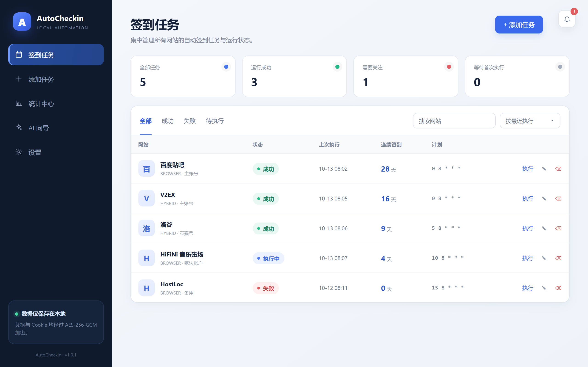

# AutoCheckin

[](https://github.com/Runa-Asahi/AutoCheckin_Engineering/actions/workflows/ci.yml) [](https://github.com/Runa-Asahi/AutoCheckin_Engineering/releases)  

闹钟还没响的时候，今天要签的到可以已经签完了。

AutoCheckin 是一款本地优先的自动签到桌面应用。任务、凭据和每一次执行记录都放在你自己的电脑上。到了你设定的时间，它用 HTTP/API、浏览器，或两种方式接续完成签到，再把结果留在本机。

> 当前正式版本：**V1.1.0** · [下载安装包](https://github.com/Runa-Asahi/AutoCheckin_Engineering/releases/tag/v1.1.0)



*任务页把网站、引擎、状态、上次执行和连续天数放在同一张表里。*

## 它每天做什么

打开应用，先看到的是一张任务表。每个网站一行：什么时候跑、上次是否成功、连续签到了多少天。成功、失败、正在执行、还在等待，用颜色分开。点进去能看执行记录；统计页汇总最近 30 天。

跑任务有三种方式，按站点来选：

- **HTTP / API**：站点有稳定接口时，直接发请求。
- **浏览器**：Playwright 打开隔离窗口，沿用已经登录过的档案。
- **混合**：接口走不通时回退到浏览器，把这一次签到做完。

做完后，系统通知会告诉你结果。日志里的密码、Cookie、Token 和 API Key 会被拿掉。任务失败时，诊断会指出可能卡在哪一步。

开机登录后可以让 AutoCheckin 留在系统托盘里继续按计划签到。关掉主窗口不会停掉调度，要从托盘菜单选择退出才会停止。启动、到点和睡眠醒来时，它只补当前这一次还没完成的签到，不会把更早漏掉的天数一并重跑。临时故障会按间隔重试；登录失效或需要人工处理时会通知你，并停在这一周期。

换电脑时，把数据导出成 AES-256-GCM 加密的 `.acbackup`，到新设备上再导入。

## 现在能签的站点

内置适配器：

| 站点 | 引擎 |
| --- | --- |
| 百度贴吧 | 浏览器 |
| HiFiNi 音乐磁场 | 浏览器 |
| HostLoc | 浏览器 |
| 洛谷 | 混合 |
| V2EX | 混合 |

登录可以用 Cookie、AutoCheckin 专用浏览器档案，或本机已经装好的 Chrome / Edge Profile。

没有现成适配器时，打开 AI 向导。它可以使用 OpenAI、Anthropic、Gemini、DeepSeek、GLM，或任何兼容接口，根据页面生成一份适配器。页面分析只接受 HTTP(S) 地址，并拒绝本机、局域网和链路本地地址。

## 数据留在这台电脑

第一次启动要设置至少 8 位主密码。它会加密保存在当前系统账户中，之后打开应用和开机自启动都不再询问。数据库密钥由 PBKDF2-SHA512 派生，凭据和 Cookie 以 AES-256-GCM 做字段级加密。

界面进程不启用 Node.js，只通过 `contextBridge` 拿到最小的一组接口。跨进程输入用 Zod 校验。

验证码、风控、反爬和账户安全措施不在这个应用的能力范围内。

## 装上就能用

发布版可以跑在 Windows 10/11、macOS 和主流 Linux 上。浏览器任务第一次执行时需要联网，用来下载匹配版本的 Chromium。如果要复用本机浏览器档案，电脑上需要已经安装 Chrome 或 Edge。

1. 从 [v1.1.0 发布页](https://github.com/Runa-Asahi/AutoCheckin_Engineering/releases/tag/v1.1.0) 下载对应平台的安装包。
2. 第一次打开时设置主密码。之后启动会自动解锁。
3. 添加任务，选一个内置适配器，或让 AI 向导帮你写一份。
4. 需要一直自动签到时，在设置里打开开机自动启动。关闭窗口后程序仍在托盘中运行。

浏览器任务建议使用 AutoCheckin 专用档案。第一次执行时，在隔离窗口里完成登录，并亲手签到一次。关掉窗口之后，后面的计划任务会继续使用这份登录状态。

## 在本机改代码

需要 Node.js 22.5 或更高版本（数据库回退与测试依赖内置 `node:sqlite`，CI 使用 Node.js 22）、pnpm 10。只有在没有预编译包时，才需要系统构建工具来编译原生依赖。

```powershell
pnpm install --frozen-lockfile
pnpm dev
```

提交前跑一遍检查、测试和构建：

```powershell
pnpm run typecheck
pnpm test
pnpm run build
pnpm test:e2e
```

打出当前平台的安装包：

```powershell
pnpm run dist
```

安装包出现在 `dist/`。这个目录不进入版本库。

## 仓库地图

```text
AutoCheckin/
├─ .github/workflows/   GitHub Actions 验证与发布
├─ docs/                工程实现说明
├─ drizzle/             数据库迁移与元数据
├─ e2e/                 Electron 端到端测试
├─ resources/adapters/  内置签到适配器
├─ src/main/            Electron 主进程、引擎与服务
├─ src/preload/         安全的 Renderer 桥接层
├─ src/renderer/        Vue 3 用户界面
├─ src/shared/          跨进程类型和校验 Schema
└─ tests/               单元与集成测试
```

## 技术栈

Electron、Vue 3、TypeScript、Element Plus、Pinia、Drizzle ORM、SQLite、Playwright、Vitest、electron-builder。

数据库优先加载 `better-sqlite3`。当前 Electron ABI 没有可用的原生模块时，应用改用 Electron 内置的 `node:sqlite`。两种后端使用同一套 Schema、迁移、WAL、外键和字段级加密。

## 发布一个版本

推送 `v*` 标签后，GitHub Actions 会在 Windows、macOS 和 Linux 上构建安装包，并创建 GitHub Release。版本记录写在 [CHANGELOG.md](CHANGELOG.md)。

## 使用之前

自动访问可能违反目标网站的用户协议。请只为自己有权使用的账户配置签到，并自己判断这样做的风险。

## 参与贡献

改代码之前先看 [CONTRIBUTING.md](CONTRIBUTING.md)。安全问题请不要写进公开 Issue，通过仓库维护者提供的私密渠道报告。
