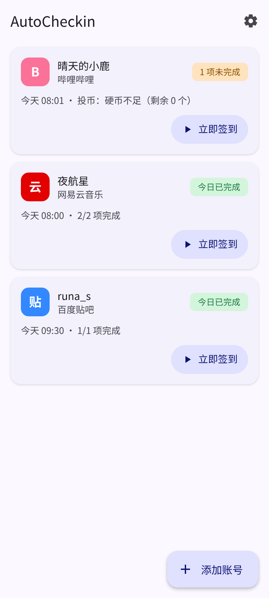
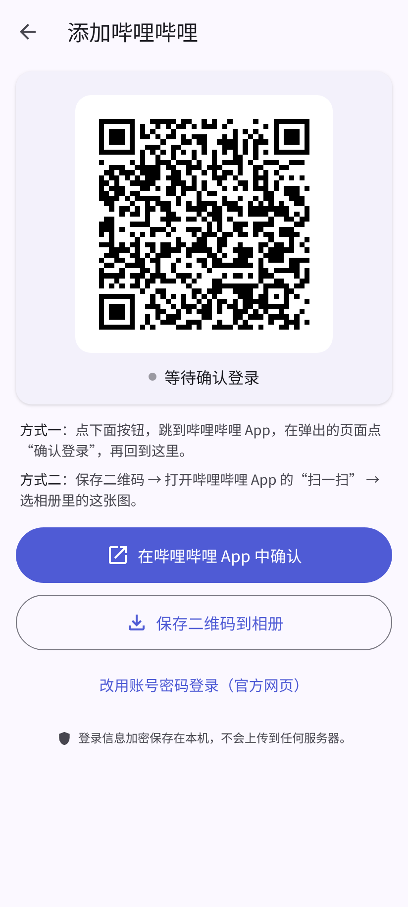
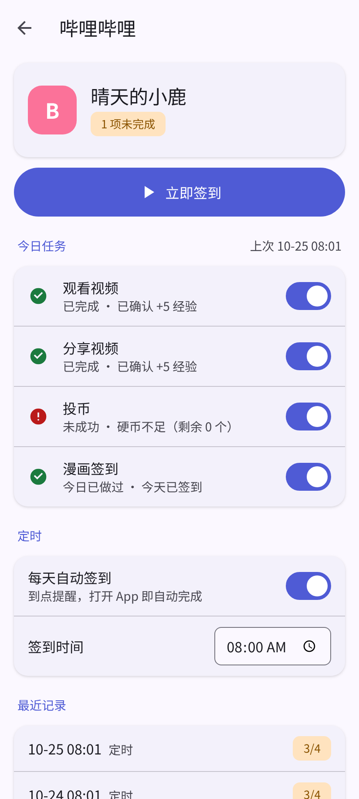

# AutoCheckin

**English:** [README.en.md](README.en.md). Automatic daily check-ins for NetEase Cloud Music, Bilibili and Baidu Tieba; the desktop app shows an English UI outside Chinese locales.

每天自动帮你签到。**扫码或用官方页面登录，不用填任何配置**；每一项任务做完都会再查一次平台状态，**确认真的成功了才显示成功**。

提供 **电脑版**（Windows / macOS / Linux）和 **安卓版**，同一套签到逻辑。数据只存在你自己的设备上。

> 当前版本：**v2.0.1**。从 v1 升级时数据不互通，需要重新添加账号。

<p>
  
  
  
</p>

## 支持的平台

| 平台 | 电脑版登录 | 安卓版登录 | 每日任务（默认） | 怎么确认成功 |
| --- | --- | --- | --- | --- |
| 网易云音乐 | 用网易云 App 扫屏幕上的码 | 二维码 +「在网易云音乐 App 中确认」/「保存到相册」；或官方网页登录 | 手机端每日签到 ✅、电脑端每日签到 ✅ | 签到后查询账号的 `mobileSign` / `pcSign` 状态；手机端第一次未生效时会再尝试一次 App 云贝签到，仍以状态为准 |
| 哔哩哔哩 | 用 B 站 App 扫屏幕上的码 | 二维码 +「在哔哩哔哩 App 中确认」/「保存到相册」；或官方网页登录 | 观看视频 ✅、分享视频 ✅、漫画签到 ✅、投 1 枚硬币（默认关闭，会消耗硬币） | 执行后查询每日经验任务 / 漫画签到状态 |
| 百度贴吧 | 弹出百度官方登录窗口（可扫码或输入账号） | App 内打开百度官方登录页 | 签到所有关注的吧 ✅ | 签完重新拉取吧列表逐个核对，显示「新签到 / 原本已签 / 未成功（含原因）」 |

## 下载

从 [v2.0.1 发布页](https://github.com/Runa-Asahi/AutoCheckin_Engineering/releases/tag/v2.0.1) 下载：

| 系统 | 文件 |
| --- | --- |
| Windows | `AutoCheckin.Setup.2.0.1.exe` |
| macOS（Apple 芯片） | `AutoCheckin-2.0.1-arm64.dmg` |
| Linux | `AutoCheckin-2.0.1.AppImage` 或 `autocheckin_2.0.1_amd64.deb` |
| 安卓 7.0 及以上 | `AutoCheckin-2.0.1-android.apk`（校验值见 `SHA256SUMS-android.txt`） |
| iOS | 暂不提供（需要 Apple 开发者签名） |

- 安装包都没有经过商业代码签名：Windows 可能弹出 SmartScreen（点「更多信息 → 仍要运行」），macOS 首次打开需在 Finder 中右键 →「打开」。
- 安卓 APK 为自签名安装包（未上架应用商店），需允许「安装未知来源应用」；可直接覆盖安装 v2 测试版（alpha.2 / alpha.3）。

## 怎么用

### 电脑版

1. 打开 AutoCheckin，点「添加账号」，选平台。
2. 网易云 / B 站：用手机上的官方 App 扫一扫屏幕上的二维码并确认；贴吧：在弹出的百度官方登录窗口登录（验证码需自己完成），完成后窗口自动关闭。
3. 默认每天 08:00 自动签到，可在账号上改时间、开关单项任务；也可以随时点「立即签到」。有任务失败时，当天会每隔 30 分钟自动重试（含第一次最多共 3 次）；登录失效不会重试。
4. 软件需要保持运行（可最小化到托盘）才能定时签到。想开机自动运行：设置里打开「开机自动启动」。

### 安卓版

1. 点右下角「添加账号」，选平台。
2. **网易云 / B 站**：App 显示官方二维码，两种方式任选：
   - 点「在 哔哩哔哩 / 网易云音乐 App 中确认」，跳到官方 App 点“确认登录”，再切回来；
   - 点「保存二维码到相册」，在官方 App 的「扫一扫 → 相册」里选这张图。
   
   切回 AutoCheckin 后会自动检测登录完成。也可以改用官方网页的账号密码登录。
3. **贴吧**：在 App 内打开的百度官方登录页正常登录即可。
4. 定时：到设定时间会弹出提醒，**点提醒或打开 App 就会自动完成**当天还没做的签到；签到结果也会以通知告诉你（可在设置里关闭）。

> 安卓的应用沙盒不允许任何 App 读取其它 App（例如已安装的 B 站客户端）里的登录信息，所以必须通过上面的方式登录一次。

## 结果怎么看

- 每个账号一张卡片：今日已完成 / N 项未完成 / 需重新登录。
- 点进账号能看到每项任务的结果和原因，例如「投币：硬币不足（剩余 0 个）」。
- 登录过期会提示「需重新登录」，重新扫码/登录即可，不会反复重试。
- 可选：在设置里开启「AI 解释失败原因」并填写你自己的 API Key（支持 OpenAI、DeepSeek、Anthropic、Gemini、Ollama 及 OpenAI 兼容服务），用大白话告诉你为什么失败、该怎么办。

## 安全与隐私

- **只在本机**：没有账号系统、没有统计/遥测、没有自建服务器。
- **网络白名单**：签到只允许以 HTTPS 访问官方域名 `music.163.com`、`bilibili.com`、`baidu.com`（及其子域名）；跳转到其它域名或被降级为 `http://` 都会被拦截，错误信息里只写目标主机名，便于排查。
- **加密保存登录信息**：
  - Windows / macOS：系统钥匙串（Electron safeStorage）；
  - Linux：优先系统钥匙串；没有时改用本机密钥文件（AES-256-GCM，权限 0600），并在设置里明确警告——**从不明文保存**；
  - 安卓：Android Keystore 保护的加密存储，另加一层字段加密；禁止系统备份 / 设备迁移；卸载即清除。
- **不记录 Cookie**；AI 解释（默认关闭）只发送脱敏后的结果文字，不发送任何登录信息。AI 请求发往你自己填写的服务地址，不受上面的平台白名单限制。
- 登录窗口 / 登录页使用临时会话，只能访问该平台官方域名，登录结束立即清空。
- 不绕过验证码、风控或任何安全措施；遇到验证码会停下并告诉你。

## 已知限制

- 各平台接口随时可能变化。贴吧签到、安卓端登录（尤其「在 App 中确认」是否直接出现确认页，取决于官方 App 版本，不行请用「保存二维码到相册」）尚缺少真机验证。遇到问题请到 [Issues](https://github.com/Runa-Asahi/AutoCheckin_Engineering/issues) 反馈（附运行结果，**不要贴 Cookie**）。
- 电脑版只有在软件运行时才会定时签到；关机或退出期间错过的任务，下次打开时（当天内）会补签。
- 安卓限制后台联网：不会在你完全不打开 App 的情况下后台签到。
- 「保存二维码到相册」需要 Android 10 及以上。
- 安卓 App 禁止截屏（保护登录二维码和账号信息），请用「保存二维码」按钮。
- B 站投币会消耗硬币，所以默认关闭；开启后每天投 1 枚，硬币不足会如实显示失败。

## 开发

需要 Node.js 22 和 pnpm 10。

```bash
pnpm install
pnpm dev                # 启动电脑版（开发模式）
pnpm lint               # 代码检查
pnpm test               # 单元测试（全部模拟，禁止真实联网）
pnpm run typecheck      # 类型检查（电脑版）
pnpm run typecheck:mobile
pnpm run build && pnpm test:e2e   # Linux 无图形界面时：xvfb-run -a pnpm test:e2e
pnpm run dist           # 打包安装包
pnpm screens:mobile     # 用演示数据渲染手机界面截图（412x915，浅色/深色）
```

安卓：`pnpm run build:mobile`（打包界面并同步到 `android/`），再在 `android/` 下 `./gradlew assembleRelease`（需要 JDK 21 + Android SDK）。签名密钥只通过环境变量 `ANDROID_KEYSTORE_PATH` 等传入，仓库里没有任何密钥；CI 从 GitHub Secrets 读取。

新增平台：在 `src/main/core/platforms/` 实现 `Platform` 接口（登录、读取资料、执行任务并**执行后确认**），在 `platforms/index.ts` 注册一行，并把官方域名加入 `src/main/core/http.ts` 的白名单。详见 [CONTRIBUTING.md](CONTRIBUTING.md)。
